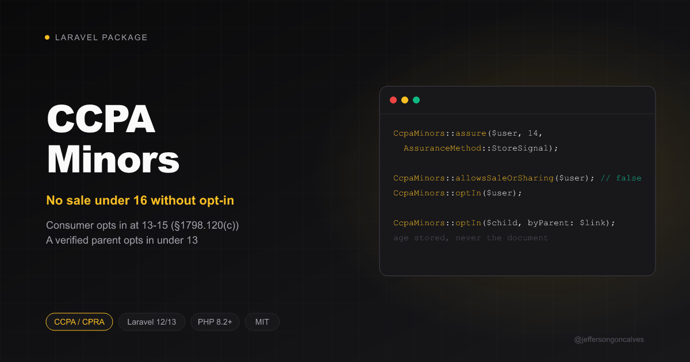

# Laravel CCPA Minors



[](https://packagist.org/packages/jeffersongoncalves/laravel-ccpa-minors)
[](https://github.com/jeffersongoncalves/laravel-ccpa-minors/actions/workflows/tests.yml)
[](https://packagist.org/packages/jeffersongoncalves/laravel-ccpa-minors)

Minors under the California Consumer Privacy Act, as amended by the CPRA. It is part of the [laravel-ccpa](https://github.com/jeffersongoncalves/laravel-ccpa) suite.

A business may not sell or share the personal information of a consumer it knows is under 16 unless that consumer opts in. Under 13, a parent or guardian has to opt in instead (Cal. Civ. Code §1798.120(c)). Willfully disregarding a consumer's age counts as knowing it.

- **Age checks as results only:** you store the age, the method and the provider, never the document or birth date. Results expire. Reliable checks outweigh self-declaration, and the youngest reliable result wins.
- **Opt-in:** from the consumer between 13 and 15, from a verified parent or guardian under 13. Either can take it back. A consumer's own opt-in stops counting if they turn out to be under 13.
- **One answer:** `allowsSaleOrSharing()`, a Blade condition and a report of minors without an opt-in.
- **Adult-only routes:** the `ccpa.adult` middleware requires a reliable adult result.

> This package gives you tooling. It does not make you compliant on its own. Combine it with [laravel-ccpa-opt-out](https://github.com/jeffersongoncalves/laravel-ccpa-opt-out): an adult's opt-out still applies.

## Installation

```bash
composer require jeffersongoncalves/laravel-ccpa-minors
php artisan vendor:publish --tag="ccpa-minors-migrations"
php artisan migrate
php artisan vendor:publish --tag="ccpa-minors-config"   # optional
```

## Usage

```php
use JeffersonGoncalves\CcpaMinors\Enums\AssuranceMethod;
use JeffersonGoncalves\CcpaMinors\Facades\CcpaMinors;

CcpaMinors::assure($user, 14, AssuranceMethod::StoreSignal);

CcpaMinors::allowsSaleOrSharing($user);   // false: under 16, no opt-in
CcpaMinors::optIn($user);                 // 13 to 15: the consumer opts in
CcpaMinors::allowsSaleOrSharing($user);   // true
CcpaMinors::revokeOptIn($user);
```

Under 13, the opt-in comes from a verified parent or guardian:

```php
$link = CcpaMinors::link($child, $parent, 'mother');
$link->verify();                          // after your verification step

CcpaMinors::optIn($child, byParent: $link);
```

Users with no age result are not treated as minors, since the law applies when you know the age. For a service directed to children, set `treat_unknown_as_minor => true`. Unknown users are then treated as under 13 and need a parent's opt-in.

The methods are `self_declaration`, `os_signal`, `store_signal`, `document`, `facial_estimation`, `verifiable_credential` and `guardian`. You choose which ones count as reliable in `reliable_methods`, and how long each is valid in `valid_for`.

### Ad tags and adult content

```blade
@ccpaMinorSaleAllowed
    <script src="https://ads.example.com/pixel.js"></script>
@endccpaMinorSaleAllowed
```

```php
Route::get('/adult', AdultController::class)->middleware(['auth', 'ccpa.adult']);
```

### Report

```bash
php artisan ccpa:minors          # users known to be under 16 without an opt-in, and who must give it
php artisan ccpa:minors --json
```

## Testing

```bash
composer test
```

## Changelog

See [CHANGELOG](CHANGELOG.md).

## License

The MIT License (MIT). See [License File](LICENSE.md).
